# AutoCAM for ncSender

**STEP file in, checked G-code out, without leaving ncSender.**
AutoCAM reads your 3D part, finds the pockets, holes, lettering and outline, plans the job with the tools loaded in ncSender, simulates every cut, checks it against your machine, and loads it.

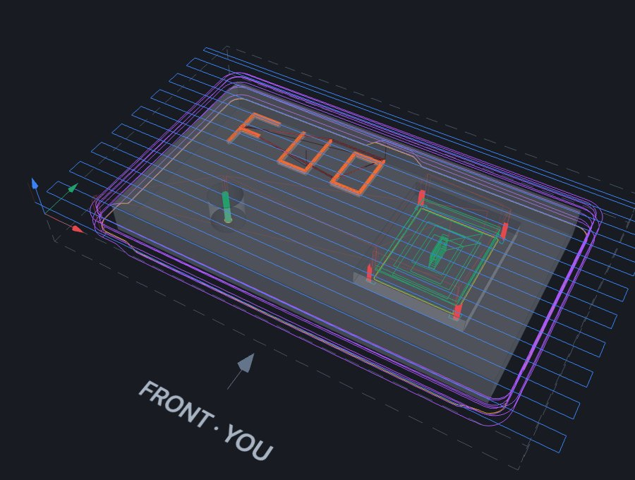

- **VCarve-style toolpaths**: Face, Engrave (V-carve), Pocket, Cut around with tabs, Finish walls, Clean up corners, Finish corners, Spot drill and Drill.
- **Your tools**: it uses ncSender's tool table and picks the right tool for each step. You can override any choice.
- **Simulation and pre-flight checks**: it catches cuts into the part, rapids through material, cuts deeper than the flutes, and moves past the travel limits.
- **ATC protection**: it won't load a job that would reach into the tool changer's keep-out zone with the current G54 zero.
- **One or two setups**: it can turn the block over and finish the other side, with a frame and web holding the part.

## Install

1. Make `ncsender-plugin-autocam.zip`: zip the contents of this repository, with `manifest.json` at the top level of the zip. You can leave out `docs/` and `examples/`.
2. In ncSender, go to **Settings → Plugins → Install Plugin → ZIP**, choose the zip, then click **Install from File** and **Enable**.
3. Open it from the **Plugins** tab → **AutoCAM**.

## Quick start

1. **Part**: drop a `.step` / `.stp` file (in mm). AutoCAM turns it so the best side faces up.
2. **Stock & zero**: pick the material, check the stock size, and click where G54 zero goes.
3. **Operations**: check the sequence and tools, and pick how to cut around the part.
4. **Simulate & load**: watch the simulation and read the checks, then press **Load into ncSender**.
5. Zero the machine where AutoCAM's setup sheet says, air-cut once (see [Testing](#testing-a-new-job)), then run it.

---

## The four steps

### 1 · Part

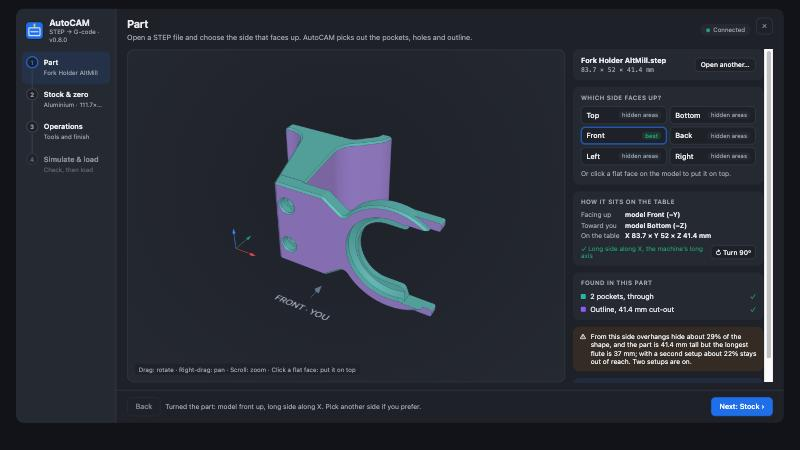

- AutoCAM picks the side to face up. It prefers a side that reaches everything in one setup and fits the Z travel. If no side does, it switches to two setups.
- The long side of the part runs along the machine's long axis.
- To change it, pick another side, click a flat face to put it on top, or press **Turn 90°**.

### 2 · Stock & zero

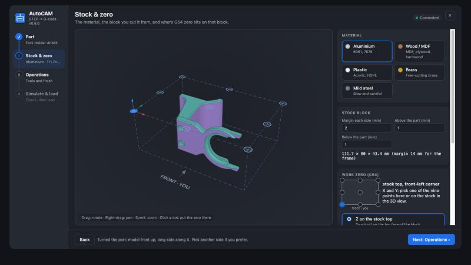

- **Material** sets cutting speed, feed per tooth, depth per pass and stepover.
- **Stock block** is the part plus a margin on each side and on top.
- **Work zero (G54)** can be any of 9 points: a corner, the middle of an edge, or the centre. Z goes on the stock top or on the spoilboard.
- **Setups**: one, or two with the block turned over.

### 3 · Operations

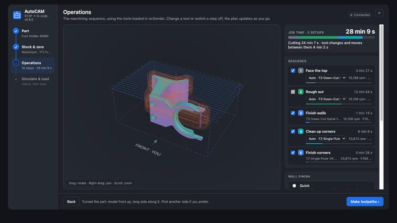

- The plan updates in the background whenever you change something.
- **Job time** shows the total, with each step's share as a coloured bar.
- **Sequence**: change the tool for a step, or untick it. Pocket and Cut around always run.
- **Around the part**:
  - *Automatic*: cuts around when the stock margin is wider than the slot, and clears otherwise.
  - *Cut around*: a slot one cutter wide along the outline, like a profile cut. The rest of the stock stays as scrap.
  - *Clear all the stock*: mills everything outside the part away.
- **Holding tabs**: when the cut goes through (**Leave at bottom** at 0 or less), tabs keep the part in the stock.
- **Wall finish**:
  - *Quick*: no finishing pass.
  - *Standard*: roughing leaves 0.2 mm on the walls, then a finishing pass takes it off.
  - *Fine*: 0.3 mm is left, with 0.2 mm steps on curves.
- **Tool table and cutting values** (folded): flute length, flutes, RPM, feed, allowances, safe Z, and tab size. Your edits are saved.

### 4 · Simulate & load

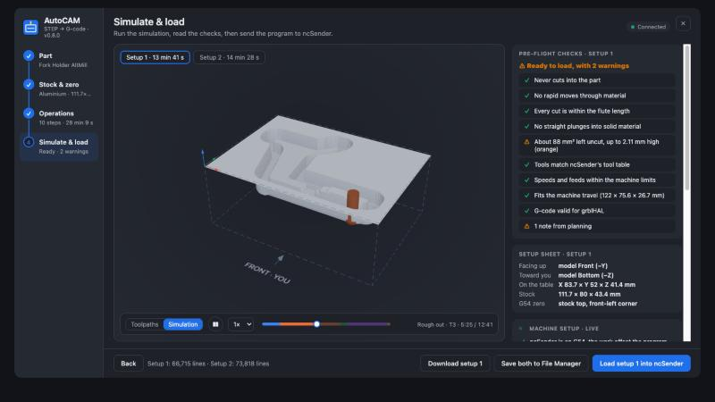

- **Simulation** cuts the stock move by move. Red marks a cut into the part; orange marks material left behind.
- **Toolpaths** shows the moves, one colour per operation. Untick operations in the list to see them one at a time.
- **Setup sheet** shows which face is up, which faces you, the stock size, and where the zero is.
- **Load into ncSender**, **Save to File Manager** (in the `AutoCAM/` folder), or **Download .nc**.

---

## Toolpaths

These screenshots are from the test part [`examples/sign.step`](examples/sign.step): a 90 × 50 × 8 mm sign with engraved letters, a pocket, an 8 mm hole, and a through-cut outline with tabs.

<table>
<tr>
<td width="50%">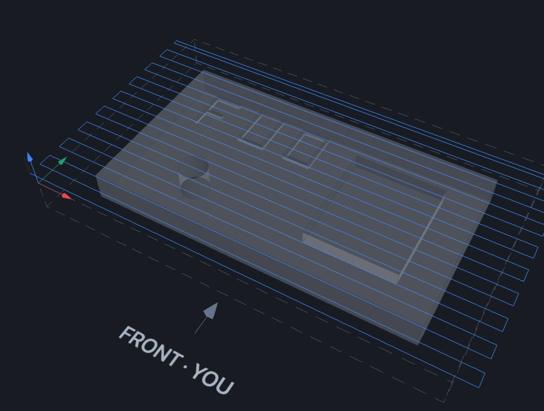</td>
<td width="50%">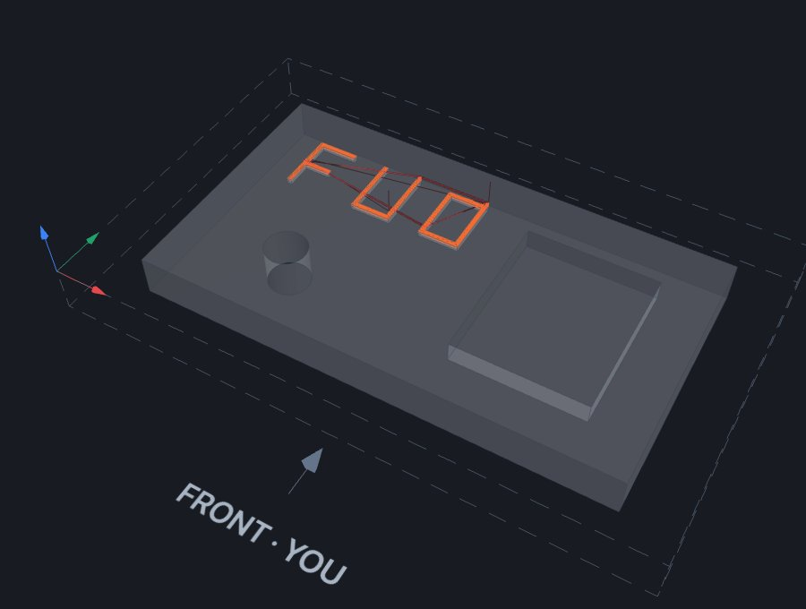</td>
</tr>
<tr>
<td><b>1 · Face the top</b> Skims the rough stock top flat, in zig-zag passes that step over 60% of the cutter. <i>Tool: surfacing bit, else the largest end mill.</i></td>
<td><b>2 · Engrave</b> V-carves lettering and grooves too narrow for any end mill. Each pass follows the groove outline, going deeper towards the middle, so the bit touches both walls. <i>Tool: the sharpest V-bit.</i></td>
</tr>
<tr>
<td>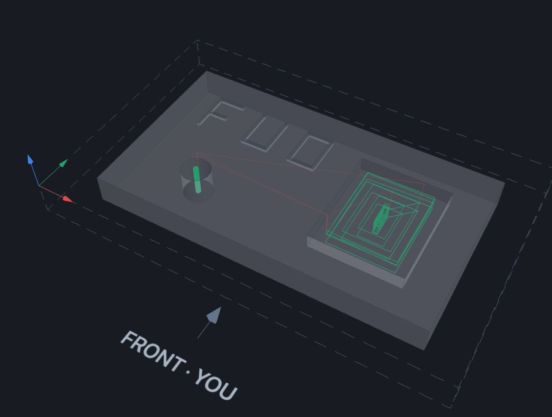</td>
<td>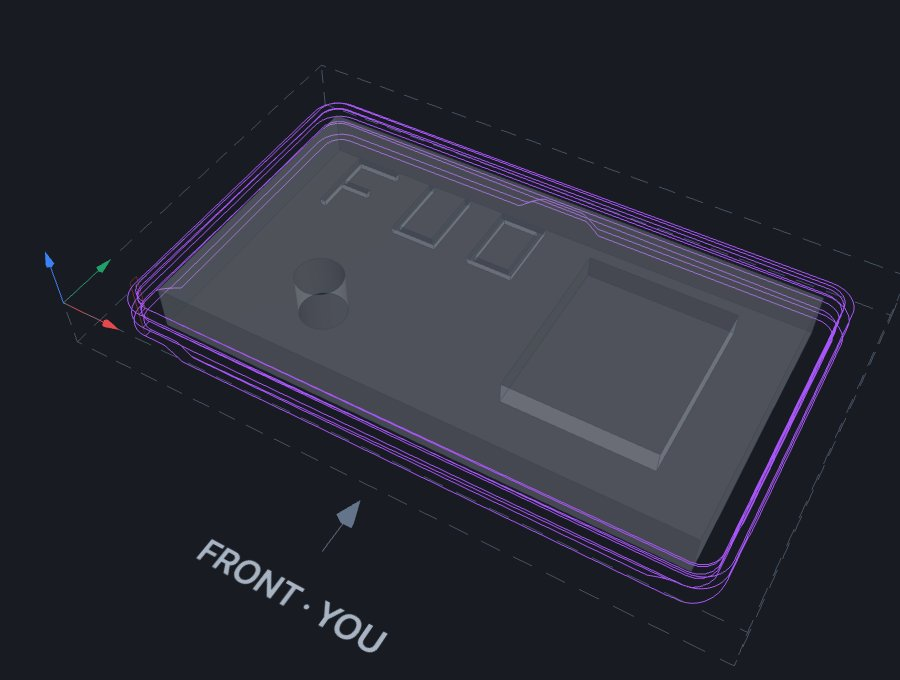</td>
</tr>
<tr>
<td><b>3 · Pocket</b> Clears closed pockets inside the outline, level by level from the inside out. It ramps in instead of plunging and stops exactly on every floor. Holes with no matching drill are helix-milled here. <i>Tool: the largest end mill that reaches the depth.</i></td>
<td><b>4 · Cut around</b> A slot along the outside of the part, or all the outside stock (see <i>Around the part</i>). It runs last among the clearing steps, so the part stays held as long as possible. On a through cut it lifts over the holding tabs. <i>Tool: same as Pocket.</i></td>
</tr>
<tr>
<td>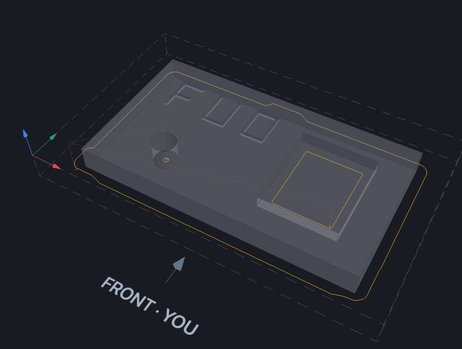</td>
<td>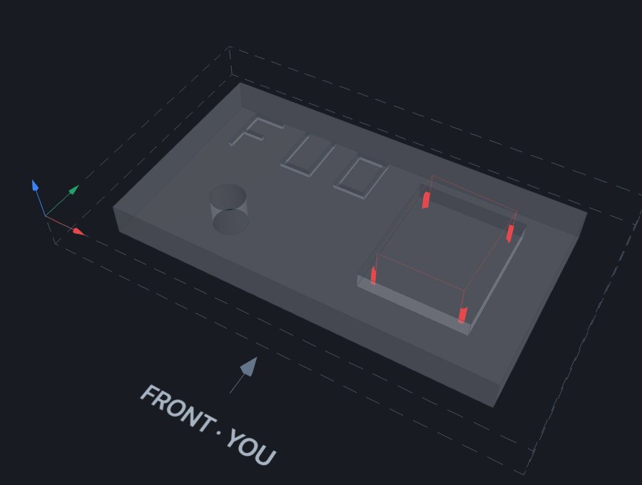</td>
</tr>
<tr>
<td><b>5 · Finish walls</b> Climb-milled contours that take off the last 0.2 mm. Straight walls get one pass from the bottom over the full flute; curved and sloped walls get a pass at each level. <i>Tool: the clearing tool, with no tool change.</i></td>
<td><b>6 · Clean up corners</b> Rest machining: clears only the corners and narrow spots the big tool couldn't reach. <i>Tool: the largest smaller end mill that fits.</i></td>
</tr>
<tr>
<td>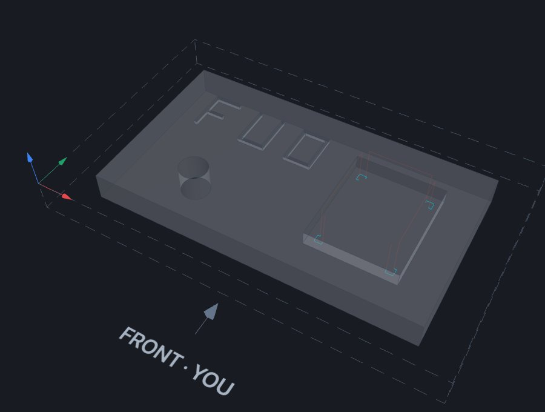</td>
<td>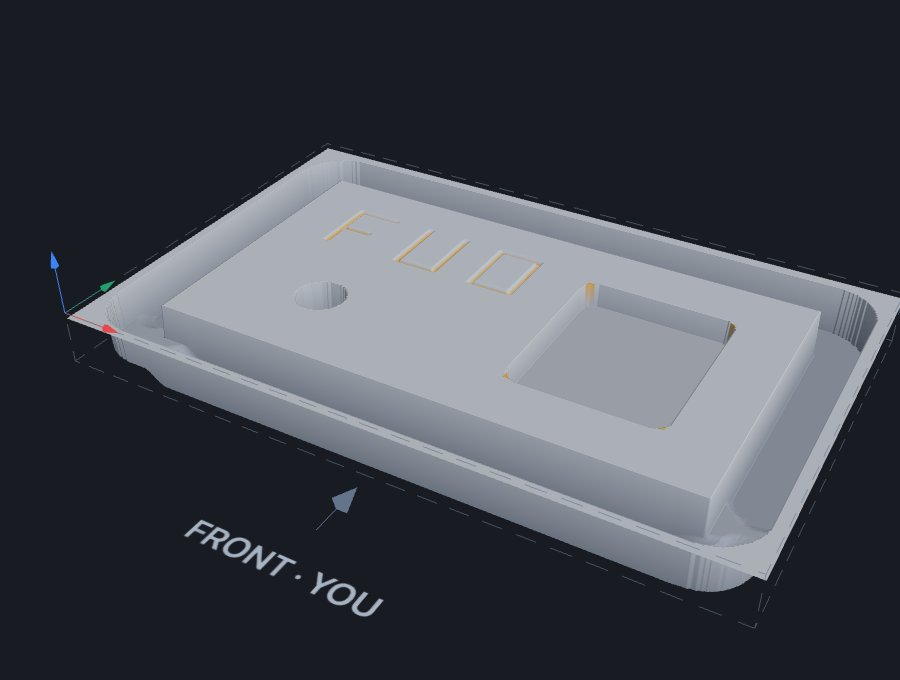</td>
</tr>
<tr>
<td><b>7 · Finish corners</b> Finishes only the stretches of wall the big tool couldn't reach. <i>Tool: the corner tool.</i></td>
<td><b>Result</b> The finished simulation: engraved letters, the pocket, the milled hole, and the slot around the part with tabs.</td>
</tr>
</table>

**8 · Spot drill and Drill**: when a drill in the tool table matches a hole (within 0.02 mm) and is long enough, the hole is spotted with the V-bit and peck-drilled. Through holes go 1 mm past the bottom. Without a matching drill, the hole is milled instead.

---

## Safety checks

| Blocks loading | Warning only |
| --- | --- |
| The tool cuts into the part | Straight plunge into solid material |
| A rapid move goes through material | Speed or feed outside the machine limits |
| A cut is deeper than the flute length | Material left uncut |
| A tool changed in ncSender since planning | Planning notes |
| The job doesn't fit the machine travel | |
| A G-code line grblHAL would reject | |
| **The job enters the ATC / keep-out zone** | |

For most failed checks you can tick *"load anyway"*. The ATC zone check can't be overridden.

### ATC zone

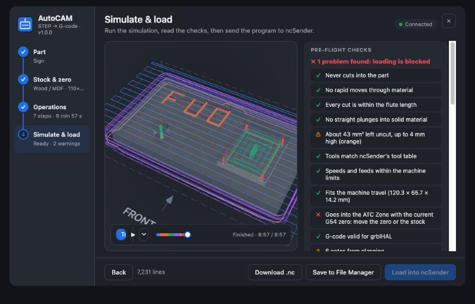

AutoCAM reads ncSender's keep-out zones, such as the ATC rack zone set by the tool-changer plugin, and the current G54 zero.
- If the stock block, or any move with the tool's radius, reaches into a zone, loading is blocked.
- It checks again the moment you press **Load**.
- If you change G54 after loading, load again so AutoCAM can re-check.

### Machine setup · live

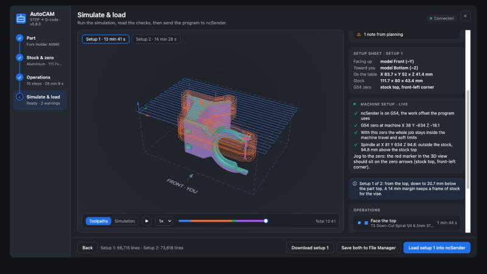

This card reads ncSender every second and shows:
- whether ncSender is on G54, and where the zero is;
- whether the job fits the soft limits with that zero;
- whether the job and stock stay out of the ATC zone;
- where the spindle is, also as a red marker in the 3D view;
- for setup 2, whether you zeroed again after turning the block over.

---

## Testing a new job

1. **On screen.** Play the simulation and check each toolpath on its own in **Toolpaths** view. The checks must show no ✗.
2. **Air cut.** Zero G54 on the stock top as usual. Then jog Z up 25 mm and set Z zero again there. Load and run the job with your hand on feed hold, and watch the tool changes, tab lifts and engraving. Set Z zero back on the stock top before the real cut.
3. **Test part.** Cut [`examples/sign.step`](examples/sign.step) in MDF or foam with these settings:
   - **Wood / MDF** material;
   - 10 mm stock margin;
   - **Leave at bottom** −0.2 (cuts 0.2 mm into the spoilboard).

   That runs every toolpath, including tabs, in about 10 minutes.

## Two setups

Use two setups when part of the shape can only be reached from below.

1. **Setup 1** cuts from the top down to the split depth. It clears a moat around the part and leaves a 6 mm frame of stock for the vise.
2. Turn the block over (the setup sheet says which way), clamp it by the frame, and zero again at the same point.
3. **Setup 2** faces the new top and cuts down to meet setup 1. It leaves a 0.5 mm web that holds the part to the frame; cut the web afterwards.

## Limits

- 2.5D only: the part is machined from the top, and from below with two setups. Sides are not machined.
- Slopes and curves are finished in 0.2–0.5 mm steps with flat end mills; there is no ball-nose finishing yet.
- Engraving is V-carving, so square-bottomed grooves get V-shaped bottom corners.
- Holder and collet collisions are not checked.
- Feeds and speeds are starting values for a hobby machine. Adjust them in the tool table.
- Always air-cut a new job first.

## Files

| File | What it is |
| --- | --- |
| `config.html` | the user interface |
| `lib/autocam-engine.js` | CAM engine: features, toolpaths, G-code |
| `lib/autocam-worker.js` | runs planning in the background |
| `lib/autocam-sim.js` | stock simulation and checks |
| `lib/three.min.js` | three.js r159 (MIT) |
| `lib/clipper.js` | Clipper polygon library (Boost) |
| `lib/occt-import-js.*` | OpenCascade STEP reader (LGPL-2.1, see `licenses/`) |
| `examples/sign.step` | test part that uses every toolpath |
